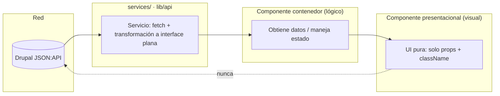
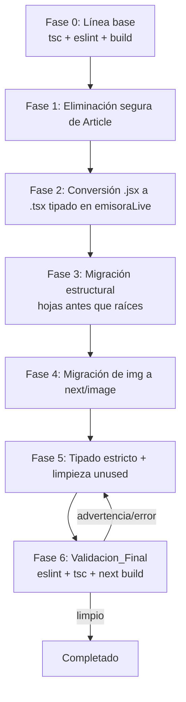

# Documento de Diseño

## Overview

Este diseño define cómo el Agente_Desarrollador ejecutará la estandarización global, remediación y limpieza del frontend Next.js (`web_institucional_frontend/`) descrita en `requirements.md`, cumpliendo estrictamente las cinco Reglas_AGENTS y la Skill_Estandarizacion.

El trabajo no introduce funcionalidad nueva: es una refactorización estructural y de calidad que debe preservar el comportamiento y el Diseno_Institucional existentes. Por eso el diseño prioriza tres garantías transversales:

1. **Seguridad de la migración**: cada cambio es reversible por componente y verificable antes de avanzar al siguiente.
2. **Integridad de importaciones**: ningún renombrado deja importaciones rotas; se usa el refactor con actualización automática de referencias y se valida con `tsc`.
3. **Preservación visual y de comportamiento**: las clases Tailwind y módulos CSS se trasladan sin alteración; las imágenes se migran a `next/image` conservando dimensiones y posición.

El resultado medible, tal como exige el Requirement 11, es que `npx eslint .` reporte **0 errores y 0 advertencias**, que `tsc --noEmit` compile sin errores y que `next build` genere la build de producción (`output: "export"`) sin errores.

### Alcance verificado del estado actual

El diseño se fundamenta en el estado real del código, inspeccionado directamente:

| Área | Estado | Acción |
| --- | --- | --- |
| `components/home/**`, `components/news-card/`, `components/news-list/` | Conformes (barrel + `[Nombre].tsx` + `[Nombre].types.ts`) | Referencia / sin cambios |
| `components/article/` + `app/[...slug]/page.tsx` + `services/articles.ts` + `services/articles.types.ts` | Ejemplo autorreferencial | Eliminación segura |
| `components/footer/` | `footer.tsx`, `footer.module.css`; múltiples `` nativas | Migrar estructura + `next/image` |
| `components/header/` (+ `audience-nav/`, `main-menu/`) | Sin barrel/tipos; `brand.tsx` con 3 `` | Migrar estructura + `next/image` |
| `components/contact-widget/` | `contact-widget.tsx`, `.module.css` | Migrar estructura |
| `components/emisoraLive/` | `.tsx` + 3 archivos `.jsx` sin tipado + `Hooks/useRadio.ts` | Migrar estructura + convertir `.jsx`→`.tsx` |
| `components/tarjet/` | `tarjet.tsx`, `.module.css` | Migrar estructura |
| `components/ti/` | `TableroIframe.tsx`, `TablerosExplorer.tsx` | Migrar estructura |

**Verificación del ejemplo Article** (grep sobre código fuente activo, excluyendo `.next/`): las únicas referencias a `components/article`, `services/articles` y `app/[...slug]/page.tsx` provienen del propio conjunto del ejemplo. El `/articulos` existente es una ruta distinta basada en el dominio de noticias, no en el ejemplo. Por tanto, los tres artefactos son Codigo_Sin_Uso elegible para eliminación (Requirement 1).

## Architecture

### Patrón objetivo de cada componente

Todo componente visual bajo `components/` converge a la Estructura_Componente, usando el patrón de referencia ya aplicado en `news-card/`:

```
components/<carpeta>/
├── index.ts                 # Barrel: re-exporta componente y tipos
├── <Nombre>.tsx             # UI + composición (presentacional/contenedor)
├── <Nombre>.types.ts        # Interfaces/types explícitos (incluye className?)
└── <nombre>.module.css      # Estilos encapsulados (se conserva tal cual)
```

Barrel de referencia (`news-card/index.ts`):

```ts
export { default as NewsCard } from "./NewsCard";
export type { NewsCardProps } from "./NewsCard.types";
```

### Clasificación de archivos dentro de una carpeta de componente

No todo archivo `.tsx` de una carpeta es un componente que requiera su propia Estructura_Componente. Se distinguen tres tipos:

- **Componente estandarizable**: unidad de UI reutilizable que debe exponerse por el barrel con su `[Nombre].types.ts`.
- **Archivo de soporte / lógica no visual**: hooks (`use-hide-on-scroll.ts`, `Hooks/useRadio.ts`), utilidades de animación (`dropdown-motion.ts`), datos de navegación (`navigation.ts`) e íconos puramente SVG (`icons.tsx`, `menu-icon.tsx`). Se **conservan como archivos dedicados separados** (Requirement 4.2) y se re-exportan por el barrel solo si se consumen fuera de la carpeta.
- **Módulo CSS**: se mantiene sin cambios de contenido; solo se renombra si fuera necesario alinear con la convención (ver nota sobre `mani-menu.module.css`).

### Diagrama: flujo de datos y separación de responsabilidades



Regla invariable (Reglas_AGENTS 1 y 2): el componente presentacional nunca hace peticiones HTTP ni conoce JSON:API; recibe datos planos por props. La transformación JSON:API → interface plana vive en la Capa de Servicios.

### Diagrama: fases de ejecución



El orden "hojas antes que raíces" en la Fase 3 significa migrar primero los componentes hoja (`main-menu/*`, `audience-nav/*`) y luego sus contenedores (`header`), de modo que al estandarizar el contenedor sus importaciones internas ya apunten a los barrels nuevos.

## Components and Interfaces

### Mapa de migración por componente

Convención de nombres: `[Nombre]` en **PascalCase** derivado del nombre semántico del componente (p. ej. `contact-widget` → `ContactWidget`, `emisora-live` → `EmisoraLive`, `audience-nav` → `AudienceNav`). Los módulos CSS conservan su nombre en kebab-case.

#### Navegación (Requirement 3)

| Carpeta destino | `[Nombre].tsx` | Notas |
| --- | --- | --- |
| `components/footer/` | `Footer.tsx` | Migrar ``→`<Image/>`; `Footer.types.ts` con `className?` |
| `components/header/` | `Header.tsx` | Contenedor; integra `Brand`, `AudienceNav`, `MainMenu` |
| `components/header/` (soporte) | `Brand.tsx` | Componente propio con barrel; migra 3 ``→`<Image/>` |
| `components/header/audience-nav/` | `AudienceNav.tsx`, `AudienceButton.tsx` | Cada uno con su `.types.ts` + barrel |
| `components/header/main-menu/` | `MainMenu.tsx` + hijos | Ver desglose abajo |

Archivos de soporte del header que **no** son componentes y se conservan como archivos dedicados: `use-hide-on-scroll.ts` (hook), `dropdown-motion.ts` (variants de animación).

#### Desglose de `main-menu/` (Requirement 3.3)

Componentes individuales que requieren su propia Estructura_Componente:

- `MainMenu.tsx` (contenedor del menú), `Aspirantes.tsx`, `Buscador.tsx`, `Campus.tsx`, `Internacionalizacion.tsx`, `NuestraUniversidad.tsx`, `OfertaAcademica.tsx`, `SearchResults.tsx`.

Archivos de soporte / lógica no visual (se conservan separados, sin convertirse en Estructura_Componente propia; se re-exportan por el barrel del menú solo si se consumen fuera):

- `navigation.ts` (datos + tipo `NavigationItem`), `icons.tsx` y `menu-icon.tsx` (íconos SVG presentacionales sin estado).

Nota sobre el módulo CSS: el archivo actual se llama `mani-menu.module.css` (typo). Dado que un renombrado de CSS no afecta el comportamiento, se renombra a `main-menu.module.css` y se actualizan sus importaciones en la misma operación de migración del contenedor, bajo la invariante de integridad de importaciones (Propiedad 2). Si por prudencia se prefiere no renombrar, se documenta y se conserva; la decisión no afecta a ESLint ni a la build.

#### Resto de componentes (Requirement 4)

| Carpeta | `[Nombre].tsx` | Soporte conservado |
| --- | --- | --- |
| `components/contact-widget/` | `ContactWidget.tsx` | Íconos SVG internos pueden extraerse o quedar locales |
| `components/emisoraLive/` | `EmisoraLive.tsx`, `Programacion.tsx`, `LiveBadge.tsx`, `PlayButton.tsx`, `VolumeSlider.tsx` | `Hooks/useRadio.ts` (hook dedicado) |
| `components/tarjet/` | `Tarjet.tsx` (o nombre semántico equivalente) | — |
| `components/ti/` | `TableroIframe.tsx`, `TablerosExplorer.tsx` | Ya tipados; añadir barrel + `.types.ts` |

### Conversión de `.jsx` a `.tsx` tipado (Requirement 9, emisoraLive)

Los tres archivos `.jsx` (`LiveBadge`, `PlayButton`, `VolumeSlider`) se convierten a `.tsx` con interfaces de props explícitas en su `[Nombre].types.ts`. Ejemplo para `LiveBadge` (hoy recibe `isPlaying` y `label` sin tipar):

```ts
// LiveBadge.types.ts
export interface LiveBadgeProps {
  /** Indica si la reproducción está activa (anima el indicador EN VIVO). */
  isPlaying: boolean;
  /** Etiqueta del badge. */
  label?: string;
  /** Clase adicional para composición. */
  className?: string;
}
```

```tsx
// LiveBadge.tsx
"use client";
import type { LiveBadgeProps } from "./LiveBadge.types";
// ...
export default function LiveBadge({ isPlaying, label = "EN VIVO", className }: LiveBadgeProps) { /* ... */ }
```

`PlayButton` y `VolumeSlider` reciben el mismo tratamiento: props tipadas (p. ej. `onToggle: () => void`, `isPlaying: boolean`, `isLoading: boolean` para `PlayButton`; `volume: number`, `onChange: (v: number) => void`, `isMuted: boolean` para `VolumeSlider`), derivadas del contrato real que ya expone `useRadio`.

El hook `Hooks/useRadio.ts` se conserva como archivo dedicado (Requirement 4.2). Tiene al final una declaración `useState(isMuted)` ubicada después de otras funciones; se reordena junto al resto de hooks al inicio del cuerpo del hook. Es una limpieza de orden que **no cambia el comportamiento** (las llamadas a hooks siguen siendo incondicionales y en el mismo orden relativo de ejecución), por lo que respeta las reglas de hooks de React y el Requirement 12.1.

### Soporte de `className` (Requirement 5)

Cada `[Nombre].types.ts` declara `className?: string`. El `[Nombre].tsx` aplica la clase al elemento raíz usando el mismo patrón de merge que `news-card` (concatenación condicional de la clase institucional base con la clase externa):

```tsx
// Patrón de merge aplicado al elemento raíz
<section className={[styles.root, className].filter(Boolean).join(" ")}>
```

Esto garantiza que: con `className`, la clase externa se suma a las clases base; sin `className`, el nodo raíz conserva exactamente sus clases institucionales (Requirement 5.2 y 5.3). `Buscador` ya acepta `className` con fallback; se formaliza en su `.types.ts`.

### Migración `` → `next/image` (Requirement 8)

Las imágenes a migrar están en `footer/footer.tsx` y `header/brand.tsx` y son **SVGs/estáticos locales en `/public`** (escudos, logotipos, aliados). Reglas de migración para preservar el layout:

- **Dimensiones (8.2)**: usar `width`/`height` explícitos cuando la imagen tiene tamaño intrínseco conocido; usar `fill` cuando el tamaño lo determina el contenedor y las clases (p. ej. contenedores con `h-*`/`w-auto`).
- **Mapeo de clases (8.3)**: trasladar las clases Tailwind/CSS existentes (`className={styles.shield}`, `h-10 w-auto`, `h-45 opacity-80`, etc.) al `<Image/>`. Cuando se use `fill`, envolver en un contenedor `relative` con las dimensiones actuales para no alterar posición ni espaciado.
- **Export estático + `unoptimized`**: `next.config.ts` tiene `output: "export"` e `images.unoptimized: true`. Para SVGs locales conviene mantener `unoptimized` en el `<Image/>` (como ya hace `Article`) para preservar el render exacto del vector.
- **`remotePatterns` (8.5)**: dado que todas las imágenes migradas son **locales en `/public`**, con `output: "export"` + `unoptimized` **no requieren** `remotePatterns`. La verificación confirma que no hay hosts remotos nuevos que declarar; `next.config.ts` no se modifica por esta causa.

Ejemplo (brand, imagen con tamaño intrínseco por CSS):

```tsx
import Image from "next/image";
// ...
<Image
  src="/escudos/escudo-ud-black.svg"
  alt="Escudo Universidad Distrital"
  width={64}
  height={64}
  className={styles.shield}
  unoptimized
/>
```

Para la fila de aliados del footer (`h-10 w-auto` en un `map`), se preservan las mismas clases y se asigna `width`/`height` acordes a la relación de aspecto del SVG, o `fill` dentro de un contenedor dimensionado, manteniendo `h-10`.

### Estados de carga y error (Requirement 6)

Se analiza **cada** componente para decidir si obtiene datos asíncronos en el cliente:

- `components/emisoraLive/` (vía `useRadio`): **sí** maneja asincronía de cliente (reproducción de audio). `useRadio` ya expone `isLoading` y transiciona a estado no reproduciendo ante `error`/fallo de `play()`. El diseño exige que `EmisoraLive`/`PlayButton` **muestren** ese `isLoading` (indicador de carga) y reflejen el estado de error de reproducción de forma visible (Requirement 6.1, 6.2).
- `components/header/main-menu/` (`Buscador`/`SearchResults`): la búsqueda actual es **en memoria** sobre `navigation.ts` (sin fetch de red). No obtiene datos asíncronos de cliente, por lo que se **omiten** estados de carga/error (Requirement 6.3). Si en el futuro `search-results` hiciera fetch cliente, pasaría a aplicar 6.1/6.2.
- `components/ti/`, `contact-widget`, `footer`, `tarjet`, `header/brand`: no obtienen datos asíncronos de cliente → se omiten estados de carga/error (6.3).

### Eliminación segura del ejemplo Article (Requirements 1 y 2)

Orden estricto para evitar importaciones rotas:

1. **Verificar** (ya hecho; repetible): grep de `components/article`, `services/articles`, `app/[...slug]` en código fuente activo. Confirmado: solo autorreferencias.
2. **Eliminar la ruta** `app/[...slug]/page.tsx` y su carpeta `app/[...slug]/` (es el consumidor; se borra primero para que nada quede importando el componente/servicio).
3. **Eliminar el servicio** `services/articles.ts` y `services/articles.types.ts`.
4. **Eliminar el componente** `components/article/` (`Article.tsx`, `Article.types.ts`, `index.ts`).
5. **Confirmar**: `tsc --noEmit` sin errores (Requirement 2.5) y 0 referencias residuales (Propiedad 3). Nota: los artefactos bajo `.next/` son caché de build generado y se regeneran; no son código fuente.

## Data Models

La tarea no define modelos de dominio nuevos. Los tipos relevantes son contratos de componentes y de servicios:

### Contrato estructural de props (todos los componentes estandarizados)

```ts
// Forma mínima común de las props de un componente estandarizado
export interface StandardizedComponentProps {
  /** Clase adicional aplicada al elemento raíz para composición. */
  className?: string;
  // ...props específicas, siempre con Tipo_Explicito (sin `any`)
}
```

### Contrato de la Capa de Servicios (Requirement 10.2)

Cuando un servicio consume JSON:API de Drupal, transforma la respuesta anidada en una **interface plana** antes de entregarla. Modelo de referencia ya presente en el proyecto (`NewsItem` consumido por `NewsCard`):

```ts
// Un servicio devuelve siempre tipos planos, nunca el envoltorio JSON:API
export interface FlatResource {
  id: string;
  // campos planos derivados de attributes/relationships de JSON:API
}
```

Los servicios del dominio de tableros (`services/tableros`) y noticias (`services/news.types`) ya exponen interfaces planas (`CategoryNode`, `Tablero`, `NewsItem`); se conservan como referencia del patrón correcto. El servicio del ejemplo (`services/articles.types.ts`, con `Articulo`/`ArticuloResult`/`ArticuloParam`) se elimina.

### Tipado estricto (Requirement 9)

- Cada prop, estado y variable heredada recibe Tipo_Explicito.
- Se elimina todo uso de `any` (`: any`, `as any`, `<any>`), sustituyéndolo por el tipo correcto o por `unknown` con estrechamiento.
- Las props de los componentes convertidos desde `.jsx` se tipan según el contrato real de `useRadio` y de sus consumidores.

## Migration Strategy

Estrategia segura, incremental y reversible por componente:

1. **Trabajar un componente a la vez.** Para cada carpeta:
   a. Crear `[Nombre].tsx` (contenido movido/renombrado desde el archivo actual) y `[Nombre].types.ts` (props con `className?` y Tipo_Explicito).
   b. Conservar el `[nombre].module.css` (renombrarlo solo si procede, p. ej. `mani-menu`→`main-menu`).
   c. Mover lógica no visual (hooks, utilidades, datos) a sus archivos dedicados.
   d. Crear `index.ts` barrel con el patrón de `news-card`.
   e. Actualizar todas las importaciones hacia el nuevo barrel/nombre.
2. **Preferir el refactor de "mover/renombrar con actualización automática de referencias"** para que las importaciones se reescriban de forma consistente; validar siempre con `tsc --noEmit` tras cada componente.
3. **Orden recomendado (hojas → raíces)**:
   - Hijos de `main-menu/` y `audience-nav/` antes que `Header`.
   - `Footer`, `ContactWidget`, `Tarjet`, `Ti` de forma independiente.
   - `emisoraLive`: convertir `.jsx`→`.tsx` tipados antes de estandarizar el contenedor `EmisoraLive`.
4. **Rollback por componente**: como cada migración es atómica (una carpeta, un barrel, sus importaciones), si `tsc`/`eslint`/`build` fallan tras un componente, se revierte solo ese componente sin afectar a los demás.
5. **Manejo de riesgos**:
   - *Importaciones rotas*: mitigadas por refactor con actualización automática + verificación `tsc` inmediata (Propiedad 2).
   - *Cambios de nombre de archivo con imports relativos internos* (p. ej. `../dropdown-motion`): revisar imports relativos tras renombrar.
   - *Alteración visual accidental*: trasladar clases sin modificarlas; revisar la build de producción y comparar visualmente (Requirement 12.2).
   - *Reglas de hooks*: al reordenar `useRadio`, mantener llamadas incondicionales y mismo orden de ejecución.

## Error Handling

El manejo de errores aplica en dos planos:

1. **Errores de proceso (remediación)**: ante cualquier fallo de `tsc --noEmit`, `npx eslint .` o `next build`, el Agente_Desarrollador detiene el avance, corrige la causa raíz en el último componente migrado y repite la verificación (Requirement 11.4). No se avanza a la siguiente fase con el árbol en estado inválido.
2. **Errores en tiempo de ejecución (producto)**: solo donde hay datos asíncronos de cliente. En `emisoraLive`, `useRadio` ya captura fallos de `play()` y eventos `error` del `Audio`, revirtiendo a estado no reproduciendo y apagando `isLoading`. El diseño exige exponer visualmente:
   - **Carga**: indicador mientras `isLoading` es verdadero.
   - **Error**: estado visible cuando la reproducción falla (p. ej. mensaje o cambio de estado del `PlayButton`).
   
   En componentes sin asincronía de cliente no se añaden estados de carga/error (Requirement 6.3), evitando complejidad innecesaria.

## Correctness Properties

*Una propiedad es una característica o comportamiento que debe cumplirse en todas las ejecuciones válidas del sistema; es decir, una afirmación formal sobre lo que el sistema debe hacer. Las propiedades son el puente entre la especificación legible por humanos y las garantías de corrección verificables por máquina.*

Las propiedades siguientes son verificables de forma automatizada. Las de tipo **invariante de árbol fuente** se evalúan recorriendo el código fuente activo (excluyendo `node_modules/` y `.next/`). Las de **comportamiento** se evalúan con pruebas de render o de transformación sobre entradas generadas.

### Property 1: Estructura de componente completa

*Para todo* directorio de componente bajo `components/` (incluyendo subcarpetas de componentes individuales), el directorio contiene exactamente un archivo barrel `index.ts` que re-exporta el componente, y existe un archivo `[Nombre].types.ts` con sus tipos explícitos.

**Validates: Requirements 3.3, 3.4, 4.3, 4.4**

### Property 2: Integridad de importaciones tras renombrar

*Para todo* archivo `.ts`/`.tsx` activo del Frontend, tras la migración no existe ninguna importación que apunte a una ruta o nombre de archivo antiguo de un componente migrado; equivalentemente, el proyecto compila con `tsc --noEmit` sin errores de módulo no encontrado.

**Validates: Requirements 3.5, 4.5**

### Property 3: Ausencia de referencias a artefactos eliminados

*Para todo* archivo fuente activo del Frontend, no existe ninguna importación ni referencia a `components/article`, `services/articles`, `services/articles.types` ni a la ruta `app/[...slug]`.

**Validates: Requirements 2.4**

### Property 4: Ausencia de imágenes nativas

*Para todo* archivo `.tsx` activo del Frontend, no existe ninguna etiqueta JSX `` nativa.

**Validates: Requirements 8.1, 8.4**

### Property 5: Ausencia del tipo `any`

*Para todo* archivo `.ts`/`.tsx` activo del Frontend, no existe ningún uso del tipo `any` (ni `: any`, ni `as any`, ni `<any>`).

**Validates: Requirements 9.2**

### Property 6: Ausencia de archivos sin tipar

*Para todo* archivo de componente bajo `components/`, su extensión es `.ts`/`.tsx` y no existe ningún archivo `.jsx`.

**Validates: Requirements 4.1, 9.1**

### Property 7: Composición mediante `className`

*Para todo* componente estandarizado y *para toda* cadena `className`, el elemento raíz renderizado incluye esa clase además de sus clases institucionales base; y *para todo* componente estandarizado sin `className`, el elemento raíz conserva exactamente sus clases institucionales base.

**Validates: Requirements 5.2, 5.3**

### Property 8: Mapeo de estado a UI en datos asíncronos de cliente

*Para todo* componente estandarizado que depende de datos asíncronos obtenidos en el cliente, cuando su estado de carga está activo la UI muestra un indicador de carga visible, y cuando su estado de error está activo la UI muestra un indicador de error visible.

**Validates: Requirements 6.1, 6.2**

### Property 9: Aplanamiento de respuestas JSON:API

*Para toda* respuesta JSON:API válida procesada por un servicio con transformación, el objeto resultante cumple la interfaz plana de TypeScript correspondiente y no expone la estructura anidada de JSON:API (`data`/`attributes`/`relationships`) al componente.

**Validates: Requirements 10.2**

## Testing Strategy

Enfoque dual (pruebas por ejemplo + pruebas de propiedad) complementado con puertas de calidad de herramientas.

### Puertas de calidad (verificaciones SMOKE/herramienta)

Son verificaciones binarias de estado global; no se expresan como propiedades universales:

- `tsc --noEmit` compila sin errores (Requirements 2.5, 9.1, 9.4).
- `npx eslint .` reporta **0 errores y 0 advertencias**, incluidas `@typescript-eslint/no-unused-vars` (7.3) y `@next/next/no-img-element` (8.4) (Requirements 11.1–11.4).
- `next build` genera la build de producción (`output: "export"`) sin errores (Requirement 12.3).

Estas tres puertas se ejecutan como línea base (Fase 0), tras cada componente migrado y en la Validacion_Final.

### Pruebas por ejemplo (unitarias / de integración)

- **Eliminación de Article**: verificar ausencia de los archivos/carpetas borrados y que `tsc` pasa (Requirements 2.1–2.3, 2.5).
- **Estructura por componente**: para los casos concretos (footer, header, contact-widget, emisoraLive, tarjet, ti) verificar existencia de `index.ts`, `[Nombre].tsx` y `[Nombre].types.ts` (Requirements 3.1, 3.2, 4.1, 4.2).
- **Imágenes**: revisar que cada `<Image/>` migrada declara `width`/`height` o `fill`, y comparación visual de la build para footer/brand (Requirements 8.2, 8.3, 12.2).
- **Separación de responsabilidades**: revisión/grep de que ningún componente presentacional hace fetch directo (Requirements 10.1, 10.3).

### Pruebas de propiedad (property-based y verificaciones deterministas)

Las Propiedades 1–6 se implementan como **verificaciones deterministas de árbol fuente** (recorren todos los archivos aplicables; "para todo archivo/directorio"): detectan `index.ts` únicos, `.types.ts` presentes, ausencia de ``, de `any` y de `.jsx`, y ausencia de referencias a artefactos borrados. Las Propiedades 7–9 son **property-based** con entradas generadas.

Si se usan pruebas property-based (Propiedades 7–9), seleccionar una librería del ecosistema (p. ej. `fast-check` para TypeScript, integrada con el runner existente del proyecto) y **no** implementar PBT desde cero. Requisitos:

- Mínimo **100 iteraciones** por prueba de propiedad.
- Cada prueba referencia su propiedad del diseño con una etiqueta en comentario:
  - Formato: `Feature: global-standardization-and-cleanup, Property {número}: {texto de la propiedad}`
- Cada propiedad se implementa con **una** prueba de propiedad.

Esquema de aplicación:

| Propiedad | Técnica | Qué se genera / verifica |
| --- | --- | --- |
| 1 | Determinista (árbol fuente) | Todo dir. de componente: 1 `index.ts` + `.types.ts` |
| 2 | Determinista + `tsc` | Sin imports a rutas/nombres antiguos |
| 3 | Determinista (árbol fuente) | Sin referencias a artefactos borrados |
| 4 | Determinista (árbol fuente) | Sin `` en `.tsx` |
| 5 | Determinista (árbol fuente) | Sin `any` |
| 6 | Determinista (árbol fuente) | Sin `.jsx` en `components/` |
| 7 | Property-based (render) | `className` generada → clase presente; sin `className` → clases base intactas |
| 8 | Property-based (estado→UI) | Estados `loading`/`error` → indicadores visibles (emisoraLive) |
| 9 | Property-based (transformación) | JSON:API válido → objeto plano conforme a la interfaz |

### Preservación de comportamiento y diseño

- La suite de pruebas existente y el `next build` deben seguir pasando tras cada fase (Requirements 7.2, 12.1).
- La preservación visual (12.2) se valida por comparación de la build de producción (y, si existe, snapshots), ya que no es computable como propiedad universal.
